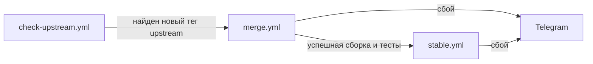
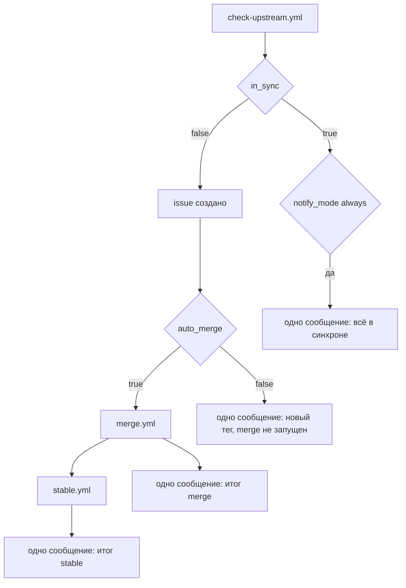

04 — Планы
Исторически извлечено из AGENTS.md; актуальный источник — этот файл.

## Текущий план — Phase C: исправления по `06-debug.md`

Статус: реализовано 13.11.2026 14:52 MSK, ожидает проверки запуском владельцем.
Отчёт о реализации — `.agents/logs/202611131452-reports.md`.

Основание: `06-debug.md` (13.11.2026 13:51) и отчёт `.agents/logs/202611131431-reports.md`.
Цель: устранить дефекты, из-за которых `merge.yml` не запускается и может автоматически
писать в `master`, а также привести цепочку workflows к схеме владельца.

Целевая цепочка запуска:

Порядок выполнения:

1. Общие соглашения для трёх workflows.
   - Закрепить runner `ubuntu-24.04` вместо `ubuntu-latest` (`06-debug.md:42-45`).
   - Ввести `TELEGRAM_NOTIFY: true|false` через repo variable и секреты уровня Environment
     (`TELEGRAM_BOT_TOKEN`, `TELEGRAM_CHAT_ID`), единый шаг уведомления (`06-debug.md:23-24`).
   - Триггеры держать закомментированными (правило 7 в `02-rules.md:16`), активными оставить
     только те, которые разрешит владелец.
   - Критерий: `actionlint` и `yamllint` без ошибок; в файлах нет `ubuntu-latest`.

2. `scripts/setup.sh`.
   - Пустой `-k/--kernel` означает обновление образа до последней версии ядра, а не `uname -r`
     (`setup.sh:115-119`, `06-debug.md:40`).
   - Перенести и упорядочить `check_os`, `validate_os_ver`, `check_deps`, `install_dnf_repos`
     из `install-amneziawg-kernel.sh:45-121`; ограничить поддерживаемые ОС CentOS Stream 10
     и родственными RHEL 9+.
   - Проверять наличие `/lib/modules/<ver>/build`; собирать модуль для `kernel-devel`
     указанной версии, не полагаясь на работающее ядро контейнера.
   - Добавить явный неинтерактивный флаг для CI; убрать неявный `dnf update -y`
     из `install_deps` (`setup.sh:72-76`).
   - Сохранить поведение: без флагов — справка и код 0; `exit` только в ветках `case`.
   - Критерий: `bash -n` и `shellcheck` без замечаний; `setup.sh` без аргументов печатает
     справку и возвращает 0; пустой `-k` приводит к установке последнего ядра.

3. `.github/workflows/check-upstream.yml`.
   - Нормализовать тег: сравнивать `v${tag#v}` с `v$(cat internal/config/version)`,
     корректно обрабатывать ветку вместо тега.
   - В тексте issue использовать `upstream_ref`, убрать ручной запуск `stable.yml`
     (`check-upstream.yml:83,87`).
   - Запускать `merge.yml` только при найденном новом теге и успешном завершении проверки
     (`06-debug.md:47`).
   - Критерий: при совпадении версий issue не создаётся и `merge.yml` не запускается;
     при новом теге создаётся одно issue и запускается `merge.yml`.

4. `.github/workflows/merge.yml`.
   - Убрать `inputs` из `env`; задать статические значения `UPSTREAM_REF=master`,
     `KERNEL_VERSION` пусто, `VDS_BRANCH=master`, а inputs разрешать ниже с значениями
     по умолчанию (`merge.yml:39-41`, `06-debug.md:12-22`).
   - Снять `required: true` с `upstream_ref` и `kernel_version`; пустая версия ядра = последняя
     (`06-debug.md:39-40`).
   - `dry_run` по умолчанию `true` и не должен становиться ложным из-за пустого `inputs`
     при `workflow_run` (`merge.yml:107`).
   - Убрать автоматический запуск (`merge.yml:7-9`, `06-debug.md:47`).
   - Реализовать правило 11: пересобирать `internal/vds/src` из смерженного `src`, проверять
     изменения корневых файлов upstream и уведомлять о них (`02-rules.md:35-44`).
   - Определять версию upstream из `src/version.h` upstream-дерева, а не из имени ветки
     (`merge.yml:92`).
   - Не оставлять токен в `.git/config` клона (`merge.yml:57-58`).
   - Вызывать `stable.yml` и ждать его успешного завершения (`06-debug.md:48`).
   - Критерий: ручной запуск с `dry_run=true` собирает и тестирует дерево, но не пишет
     в `master`; при `dry_run=false` после успеха запускается `stable.yml`.

5. `.github/workflows/stable.yml`.
   - Оставить единственный вход — `workflow_call` из `merge.yml`; убрать `workflow_dispatch`
     и `workflow_run` (`stable.yml:4-7`, `06-debug.md:49`).
   - Тегировать коммит `origin/master`, ветку `stable` создавать явно из `master`
     (`stable.yml:74-80`).
   - Закрепить runner, добавить `TELEGRAM_NOTIFY` и секреты Environment.
   - Критерий: без вызова из `merge.yml` workflow не запускается; тег и `stable`
     указывают на один и тот же коммит `master`.

6. Сверка документации и журналов.
   - Обновить `01-purpose.md` и `02-rules.md`, если меняется способ вызова `stable.yml`.
   - Записать найденные дефекты в `05-issues.md`, результат — в новый отчёт
     `.agents/logs/YYYYMMDDHHMM-reports.md`.
   - Критерий: `03-tasks.md`, `04-plans.md`, `05-issues.md`, `06-debug.md` не противоречат
     друг другу; `make -C src print-version` возвращает `3.1.20260812-vds`.

Ограничения:
- Workflows самостоятельно не запускать; владелец тестирует в ручном режиме (правило 7).
- Триггеры workflow держать закомментированными, пока владелец не разрешит.
- Исходный код upstream в ветке `master` не редактировать; правки — только через
  `internal/vds/src` и временный образ `merge.yml`.

Принятые решения:
1. `stable.yml` вызывается из `merge.yml` через `workflow_call`; ожидание обеспечивает
   зависимость job, отдельный опрос статуса не нужен.
2. Версия при `upstream_ref`, равном ветке, читается из `src/version.h` upstream-дерева;
   для тега берётся имя тега без префикса `v`.
3. Прямой push в `master` сохранён (соответствует `01-purpose.md`); PR не вводится.
4. Для «последней версии ядра» достаточно `dnf install kernel kernel-devel kernel-headers`:
   `dnf update` не устанавливает отсутствующие пакеты, а в контейнере ядро не установлено.
5. Блок `environment: telegram` добавлен во все три workflows; владельцу нужно создать
   окружение `telegram` и добавить в него `TELEGRAM_BOT_TOKEN` и `TELEGRAM_CHAT_ID`.

## Phase D: единый контракт уведомлений

Статус: реализовано 13.11.2026 16:15 MSK, ожидает проверки запуском владельцем.
Отчёт — `.agents/logs/202611131615-reports.md`. Основание — `06-debug.md` (13.11.2026 16:15)
и лог `.agents/logs/debug/131120261554-check-upstream.yml.log`.

Проблема: при одновременно включённых `NOTIFY_ON_UPDATE` и `NOTIFY_ON_RESULT`
`check-upstream.yml` отправлял два Telegram-сообщения об одном событии, а сам
`NOTIFY_ON_UPDATE` управлял не уведомлением, а запретом автозапуска `merge.yml`.

Целевая схема:

Контракт:
- `notify_mode` — `choice` в `workflow_dispatch`, `string` в `workflow_call`;
  значения `none|inherit|changes|always`, default `none`.
- `none` и `inherit` не переопределяют env: действует `vars.NOTIFY_MODE`,
  при пустом значении — `changes` (прежнее поведение: сбои сообщаются всегда).
- `changes` и `always` имеют приоритет над env.
- `changes` — только значимое событие или сбой; `always` — плюс «ничего не изменилось».
- `vars.TELEGRAM_NOTIFY=false` — глобальный kill-switch, отключает всё независимо от режима.
- `auto_merge` (boolean, default `false`) — единственный переключатель автозапуска `merge.yml`;
  `run_merge` и `NOTIFY_ON_UPDATE` удалены.
- Один шаг уведомления на прогон: два сообщения физически невозможны.

Порядок выполнения:
1. `check-upstream.yml`: `auto_merge`, `notify_mode`, шаг `Resolve notification mode`,
   единый шаг `Notify Telegram`.
2. `merge.yml`: `notify_mode` в обоих триггерах, выход job `notify_mode`,
   передача в `stable.yml`, уведомление о корневых файлах под режимом.
3. `stable.yml`: `notify_mode` в `workflow_call`, единый шаг уведомления.
4. Проверка: разбор YAML, отсутствие `NOTIFY_ON_UPDATE`/`NOTIFY_ON_RESULT`/`run_merge`.

Критерий: `notify_mode=none` — ни одного сообщения; `changes` — одно сообщение только
при новом теге или сбое; `always` — одно сообщение на любой исход.

## Выполненные этапы

- [x] Phase A — документация `.agents`, README и INSTALL.
  Критерий готовности: нет битых ссылок и противоречий, все правила согласованы с версией
  `3.1.20260812-vds`. Английские версии `docs/*_en.md` вынесены в Backlog.
- [-] Phase B — `src/Makefile`, `internal/config`, `check-upstream.yml`, `setup.sh`, `merge.yml`,
  `stable.yml`.
  Критерий готовности: `make print-version` возвращает `3.1.20260812-vds`; workflows проходят
  `actionlint`/`yamllint`; `setup.sh` без аргументов выводит справку и завершается с кодом 0.
  Makefile и `internal/config` закрыты; workflows и `setup.sh` требуют доработки в Phase C.

## Backlog

- Привести в порядок `docs/*.md` и создать английские версии `*_en.md`.
- Проверить и при необходимости обновить `README.md`/`INSTALL.md` после тестирования workflows.
- Разобрать замечания из `05-issues.md` по мере закрытия задач.
